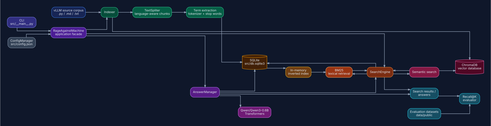
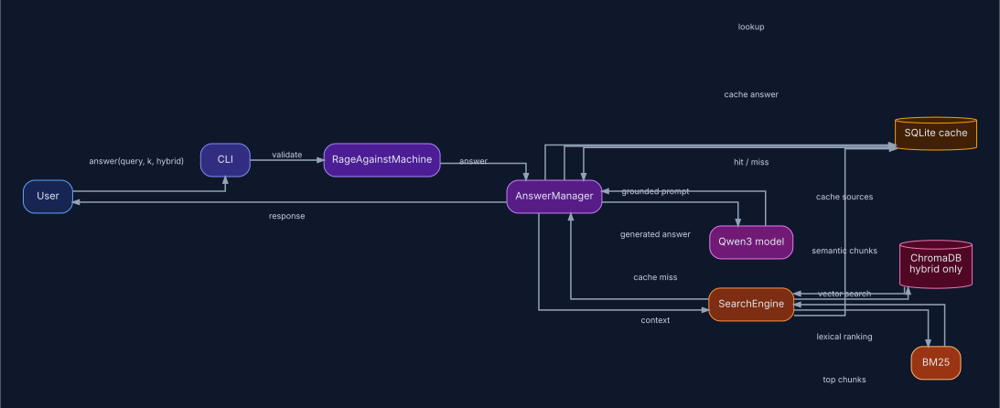
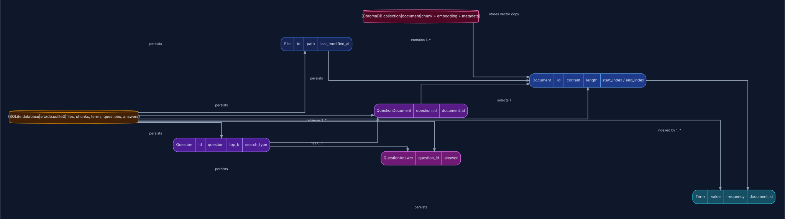
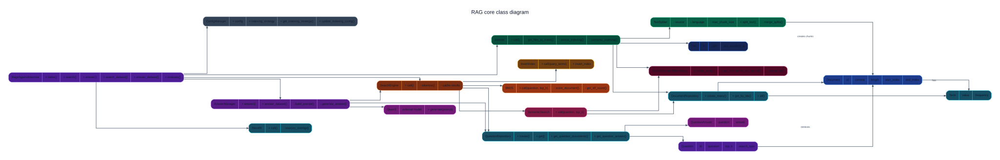

_This project has been created as part of the 42 curriculum by ytaoussi._

# Rage Against the Machine

## Description

Rage Against the Machine is a retrieval-augmented generation (RAG) system for
answering questions about the
[vLLM 0.10.1](https://github.com/vllm-project/vllm/tree/v0.10.1) source
code and documentation. It indexes Python, Markdown, and text files, retrieves
the most relevant passages for a question, and can either print the retrieved
sources or use them as context for a generated answer.

The project is intentionally split into two concerns:

- **Retrieval:** build an index over the corpus and return relevant chunks with
  their source file and character offsets.
- **Generation:** pass the retrieved context to `Qwen/Qwen3-0.6B`, with a
  prompt that instructs the model to answer only from the supplied context.

The command-line entry point is implemented in
[`src/__main__.py`](src/__main__.py), and the main application facade is
[`RageAgainstMachine`](src/core/rage_against_machine/__init__.py).

## System architecture

The pipeline is composed of the following components:

1. **Corpus loader:** walks `data/raw/vllm-0.10.1` and indexes `.py`, `.md`,
   and `.txt` files. File metadata and modification times are stored in
   SQLite.
2. **Chunker:** [`TextSpliter`](src/core/chunker/text_spliter.py) recursively
   splits each file using language-specific separators and preserves the
   original character offsets.
3. **Lexical index:** each chunk is stored as a `Document`; normalized terms
   and their frequencies are persisted in SQLite and exposed through an
   in-memory inverted index.
4. **Semantic index (optional):** hybrid indexing stores the same chunks in a
   ChromaDB collection. Chroma generates embeddings and performs vector
   similarity search.
5. **Search engine:** [`SearchEngine`](src/core/search_engine/search_engine.py)
   tokenizes the question, loads the required postings, runs lexical BM25
   retrieval, and optionally combines it with semantic retrieval. Results are
   cached by question, retrieval type, and `k`.
6. **Answer manager:** retrieves cached documents, constructs a grounded
   prompt, and lazily loads `Qwen/Qwen3-0.6B` through Transformers. Generated
   answers are cached in SQLite.
7. **Evaluation:** the Recall@K evaluator compares retrieved file/character
   ranges with ground-truth ranges from the supplied datasets.

The primary persistent stores are `src/db.sqlite3` for relational metadata,
terms, questions, and answers, and `data/processed/vector_db/chroma.sqlite3`
for semantic retrieval data. Generated databases and output directories are
ignored by Git.

## UML diagrams

The architecture diagrams are provided as SVG images for reliable rendering in
GitHub, VS Code, and other Markdown viewers. The editable Graphviz sources are
available in [`docs/diagrams/`](docs/diagrams/).

### Component diagram



This diagram shows the corpus ingestion, indexing, lexical and semantic
retrieval, answer generation, persistence, and evaluation components.

### Retrieval and answer sequence



This diagram shows how a user question travels through validation, cache
lookup, retrieval, prompt construction, model generation, and answer caching.

### Persistence and database UML diagram



This diagram shows the SQLite entities and relationships, together with the
ChromaDB vector collection used by semantic retrieval.

### Core class diagram



This class diagram covers the important runtime classes for orchestration,
configuration, indexing, chunking, retrieval, answer generation, repositories,
evaluation, and domain entities.

## Chunking strategy

Chunking is character-based, with a default maximum preferred chunk size of
2,000 characters (the CLI accepts values from 401 through 2,000).
`TextSpliter` applies a separator hierarchy and recursively falls back to
finer separators when a section is too large:

- **Python:** class definitions, function definitions, blank lines, lines,
  spaces, then individual characters.
- **Markdown:** headings, fenced-code boundaries, thematic breaks, blank
  lines, lines, spaces, then individual characters.
- **Plain text:** paragraphs, lines, spaces, then individual characters.

Small adjacent sections are merged until the configured limit is reached.
Chunks retain their start and end character positions, so search results can
point back to the exact region of the original file. Python identifiers are
also expanded for indexing: both `snake_case` components and camelCase
components become searchable terms. This preserves useful code boundaries
without requiring an AST parser.

## Retrieval method

### Lexical retrieval

The default strategy is a SQLite-backed inverted index with BM25 ranking,
implemented in [`lexical_search.py`](src/core/search_engine/lexical_search.py).
Queries are lowercased, tokenized, and filtered for stop words. For Python
queries and documents, compound identifiers are expanded.

BM25 combines:

- inverse document frequency, rewarding terms that are uncommon in the corpus;
- saturated term frequency, so repeated terms have diminishing returns; and
- document-length normalization, controlled by `k1 = 1.2` and `b = 0.75`.

The top `k` chunks are returned in descending score order.

### Hybrid retrieval

With `--hybrid=true`, lexical retrieval supplies 70% of the requested results
and ChromaDB semantic retrieval supplies the remaining 30%. The two result
lists are concatenated in that order. Hybrid indexing must be performed before
hybrid search so that the vector collection exists.

## Performance analysis

The project evaluates retrieval with Recall@1, Recall@3, Recall@5, and
Recall@10. For each question, a hit is counted when a retrieved source
overlaps a ground-truth source in both file path and character range; recall
is the fraction of relevant sources hit within the first `k` results. Run
`evaluate` to print the four aggregate scores.

The repository does not commit a fixed benchmark table, so scores and
latencies depend on the corpus, machine, chunk size, and whether semantic
indexing is enabled. Lexical retrieval is generally cheaper after indexing:
the inverted index only loads postings for query terms and avoids embedding
inference. Hybrid retrieval can improve semantic matches, but costs additional
embedding work during indexing and vector search at query time. A fair
comparison should keep the corpus and `k` constant and record indexing time,
query latency, and all four Recall@K values for lexical and hybrid modes.

## Design decisions

- **BM25 instead of raw term counts:** reduces long-document bias and
  discounts common terms.
- **Language-aware recursive splitting:** keeps Python definitions and
  Markdown sections more coherent than fixed-width slicing alone.
- **Character offsets in every chunk:** makes results auditable and allows
  evaluators to compare source ranges rather than only filenames.
- **SQLite plus ChromaDB:** uses a relational store for metadata and exact
  lexical data, while delegating vector persistence and similarity search to a
  specialized store.
- **Incremental indexing:** file modification times are checked so unchanged
  corpus files can be reused.
- **Grounded answer prompt:** the model is explicitly told not to extrapolate
  and to state when the context is insufficient.
- **Cached retrieval and answers:** repeated questions with the same retrieval
  settings avoid unnecessary work.

## Challenges faced

- **Preserving source context while limiting chunk size:** recursive,
  language-specific separators and source offsets balance retrieval granularity
  with traceability.
- **Searching code identifiers:** ordinary tokenization misses relationships
  expressed through `snake_case` and camelCase, so identifier components are
  indexed separately.
- **Combining lexical and semantic signals:** hybrid mode uses a predictable
  70/30 result allocation rather than attempting to compare incompatible BM25
  and vector scores directly.
- **Measuring retrieval fairly:** Recall@K matches source ranges with overlap,
  which accounts for a relevant answer spanning a chunk boundary.
- **Keeping generated answers grounded:** the prompt limits the model to
  retrieved context and provides an explicit no-answer response for missing
  information.

## Instructions

### Requirements

- Python 3.10 or newer
- [uv](https://docs.astral.sh/uv/)
- Enough disk space for the vLLM corpus, SQLite/ChromaDB indexes, and the
  Hugging Face model cache when using `answer`

### Installation

From the repository root:

```bash
make install
```

This runs `uv sync` and applies the Django migrations. The project can also be
installed without `make`:

```bash
uv sync
uv run python -m src.server.manage migrate server
```

### Index the corpus

Build the default lexical index:

```bash
uv run python -m src index --max_chunk_size=2000 --hybrid=false
```

Build both the lexical and semantic indexes:

```bash
uv run python -m src index --max_chunk_size=2000 --hybrid=true
```

The index command expects the corpus at
`data/raw/vllm-0.10.1`. Indexing only supports chunk sizes between 401 and
2,000 characters. The current strategy and chunk size are saved in
`src/config.json`; rerunning the command can perform incremental indexing.

## Example usage

### Search

Retrieve the top five lexical chunks:

```bash
uv run python -m src search "How does the scheduler batch requests?" --k=5 --hybrid=false
```

Retrieve using the hybrid index:

```bash
uv run python -m src search "How does the scheduler batch requests?" --k=5 --hybrid=true
```

`k` must be between 1 and 10. The command prints each result's source path
and `[start:end]` character range.

### Generate an answer

After indexing, generate a grounded answer:

```bash
uv run python -m src answer "How does the scheduler batch requests?" --k=5 --hybrid=false
```

The first answer request may download `Qwen/Qwen3-0.6B` from Hugging Face.
Use `--hybrid=true` only after a hybrid index has been built.

### Dataset search and evaluation

Search an unanswered-question dataset and write the results under
`data/output/search_results/`:

```bash
uv run python -m src search_dataset \
  --dataset_path=data/public/UnansweredQuestions/dataset_code_public.json \
  --save_directory=data/output/search_results/ \
  --k=10 \
  --hybrid=false
```

Evaluate the generated result file against its ground truth:

```bash
uv run python -m src evaluate \
  --student_search_results_path=data/output/search_results/dataset_code_public.json \
  --dataset_path=data/public/AnsweredQuestions/dataset_code_public.json
```

The Makefile provides shortcuts for common stages:

```bash
make index
make evaluate
make pipeline
```

`make pipeline` runs the public dataset preparation, indexing, and evaluation
steps using the paths declared in [`Makefile`](Makefile). For custom queries,
prefer the explicit commands above because `search` and `answer` require
their `k` argument.

## Repository layout

```text
src/core/chunker/         Language-aware document splitting
src/core/indexer/         Corpus traversal and index construction
src/core/search_engine/   BM25, semantic, and hybrid retrieval
src/core/answer_manager/  Grounded answer generation and caching
src/core/recallk/         Recall@K evaluation
src/server/               Django models, repositories, and migrations
src/vector_db/            ChromaDB integration
data/public/              Public evaluation datasets
data/raw/                 Source corpus expected by the pipeline
```

## Resources

### RAG on code base:

https://medium.com/google-cloud/build-a-rag-system-for-your-codebase-in-5-easy-steps-a3506c10599b

### AST Modules python:

https://www.youtube.com/watch?v=A0vR3l1X-CU

### Chunk strategy:

https://mbrenndoerfer.com/writing/document-chunking-rag-strategies-retrieval#sentence-based-chunking

### Retrieval augmented generation system book:

https://mallahyari.github.io/rag-ebook/intro.html

### Invert Index:

https://www.geeksforgeeks.org/dbms/inverted-index/

Build your chunker in increasingly sophisticated stages:

File-based: one file = one chunk (baseline).
AST-based: one function or class = one chunk.
Parent-aware: methods include class context.
Dependency-aware: attach relevant imports and constants to each chunk.
Hierarchical: maintain relationships such as repository → module → class → method.
Semantic: merge or split chunks based on token limits while preserving logical boundaries.
This progression mirrors how many production RAG codebases evolve, moving
from simple syntax-aware chunking to richer, context-preserving retrieval.

### Project of chunking using ast

https://github.com/yilinjz/astchunk.git

### chunking algo

```text
Algorithm 1 AST-based Chunking Algorithm
MAX_SIZE ← maximum chunk size

function CHUNKCODE(code)
    tree ← PARSEAST(code)
    if GETSIZE(code) ≤ MAX_SIZE then
    return [tree]
    else
    return CHUNKNODES(tree.children)
    end if
   end function

function CHUNKNODES(nodes)
    chunks ← [ ], chunk ← [ ], size ← 0
    for node in nodes do
        s ← GETSIZE(node)
        if (chunk = [] and s > MAX_SIZE) or
            (size + s > MAX_SIZE) then
            if chunk̸ = [ ] then
                chunks.append(chunk)
                chunk, size ← [ ], 0
        end if
        if s > MAX_SIZE then
            subchunks ← CHUNKNODES(node.children)
            chunks.extend(subchunks)
            continue
        end if
        else
            chunk.append(node); size ← size + s
            end if
            end for
            if chunk̸ = [ ] then
            chunks.append(chunk)
        end if
    return chunks
end function
```

### ALGO OF CHUNKING THE CODE

https://www.cs.cmu.edu/~sherryw/assets/pubs/2025-cast.pdf

### Langchain text spliter

https://github.com/langchain-ai/langchain/tree/master/libs/text-splitters

### Image for BM25 system

https://docs.weaviate.io/assets/images/bm25_operators_light-fe6a283b72823515e7f70dc0a6fc6d29.png

### Retrieval systems:

https://nlp.stanford.edu/IR-book/

### Benchmark:

More than 1h => 6:09 (without inserting the document terms) => 5:49
(without inserting the document terms) => 4:15 => 1.30

### Vector embedding

https://www.youtube.com/watch?v=gl1r1XV0SLw

### Vector indexing:

https://medium.com/@myscale/understanding-vector-indexing-a-comprehensive-guide-d1abe36ccd3c

### How to build vector storage

https://oneuptime.com/blog/post/2026-01-30-rag-vector-storage/view

### HNSW search:

https://www.youtube.com/watch?v=77QH0Y2PYKg

https://www.youtube.com/watch?v=rhZgXNdhWDY

### Skipped linked list

https://ocw.mit.edu/courses/6-046j-introduction-to-algorithms-sma-5503-fall-2005/resources/lecture-12-skip-lists/

https://www.youtube.com/watch?v=2g9OSRKJuzM

### AI usage

AI tools were used as an implementation aid, not as a substitute for testing
or design decisions. They were used to:

- explore and summarize the existing repository structure;
- help draft and organize this README in English;
- review explanations of RAG architecture, chunking, BM25, vector search,
  and Recall@K;
- suggest clearer command examples and documentation wording.

The project code, configuration, retrieval design, evaluation logic, and final
documentation were checked against the repository implementation. No
credentials or private data were provided to AI tools.
